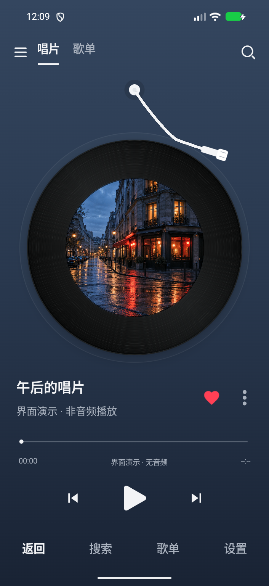

# MUSIC++

一个基于 [LX Music 移动版](https://github.com/lyswhut/lx-music-mobile) 改造的开源 Android 音乐播放器，使用 React Native 与原生 Compose 黑胶播放界面。

**[下载安卓安装包 APK](https://github.com/margaretbriggs18101985rgu-crypto/music-plus/releases/latest)** · [查看源码](https://github.com/margaretbriggs18101985rgu-crypto/music-plus) · [反馈问题](https://github.com/margaretbriggs18101985rgu-crypto/music-plus/issues)

## 在安卓手机上安装

1. 用手机浏览器打开上面的下载页，在 **Assets / 资源** 中点击 `music-plus-v1.0.0-universal.apk`。这个通用包包含四种架构，适合不确定手机型号的用户。
2. 下载完成后打开 APK；如系统提示，允许当前浏览器或文件管理器“安装未知应用”，然后按系统提示安装。
3. 打开 **MUSIC++**。首次启动阅读使用说明后，按需授予音乐文件等权限。

Android 5.0 及以上；常见 64 位安卓手机也可下载体积更小的 `arm64-v8a.apk`。`armeabi-v7a` 用于旧款 32 位 ARM 设备，`x86` / `x86_64` 用于对应设备或模拟器。下载页同时提供 SHA-256 校验文件。

安卓安装文件是 **APK**。本项目目前只构建 Android，不提供 Windows EXE。iPhone 和 HarmonyOS NEXT 不适用此安装包。

MUSIC++ 使用独立应用标识 `io.github.musicplus.player`，可以与原版 LX Music 并存；首次安装不会迁移原版应用的数据。后续请从本仓库 Releases 下载更新，使用同一签名覆盖安装。

## 功能与预览

- 音乐搜索、歌手歌曲与专辑浏览、榜单和歌单。
- 我的音乐、收藏、播放队列、歌单导入。
- 原生黑胶唱片播放页、歌词、播放进度和后台播放。
- 内置音源及自定义音源管理；第三方服务的可用性取决于各自端点。



## 从源码构建

需要 Node.js 24.22.0、JDK 17 和 Android SDK API 36。完整工具链与配置见 [Android 构建说明](doc/ANDROID_BUILD.md)。

```sh
git clone https://github.com/margaretbriggs18101985rgu-crypto/music-plus.git
cd music-plus
npm ci
npm run typecheck
npm run lint
npm test
npm run pack:android:debug
```

独立调试 APK 输出到 `build/apk/`，安装后无需电脑运行 Metro。正式签名与 GitHub 自动发布见 [发布指南](doc/RELEASING.md)。`tools/ui-preview` 是独立的浏览器预览项目，不参与 APK 构建。

## 开源与致谢

本项目基于 **lyswhut / LX Music Mobile v1.9.1** 修改，保留原作者署名、[Apache-2.0 许可证](LICENSE)、[NOTICE](NOTICE) 及[原项目说明与附加条款](doc/UPSTREAM_README.md)。MUSIC++ 的界面、原生黑胶播放器和发布配置等修改记录可查阅 Git 历史与 `doc/`。

内置墨澜音源 v2.3.4 来自 [baiji6/molanyinyueyuan](https://github.com/baiji6/molanyinyueyuan)，其 [MIT 许可证](android/app/src/main/assets/licenses/molanyinyueyuan-MIT.txt) 随源码与 APK 分发。音乐、封面、歌词等内容的权利属于各自权利人，请尊重版权，支持正版。项目不附带歌曲文件。

目前已完成的验证与仍需真机确认的项目见 [验收记录](design-qa.md)。
